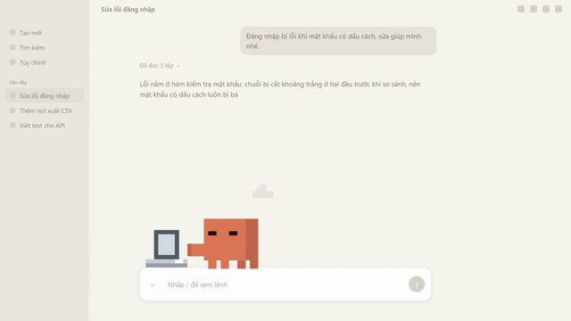
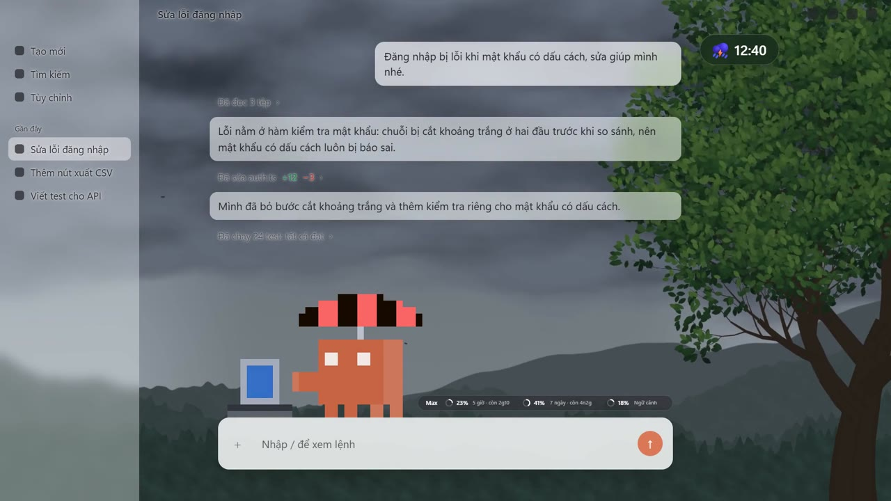
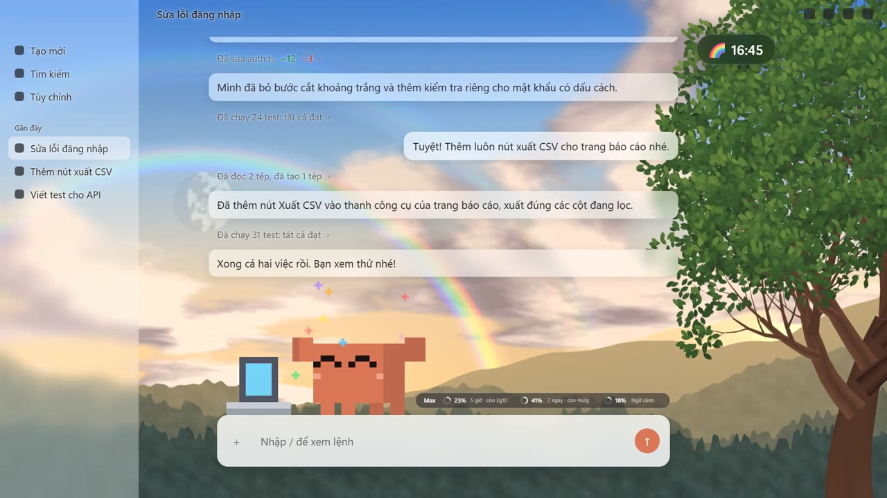
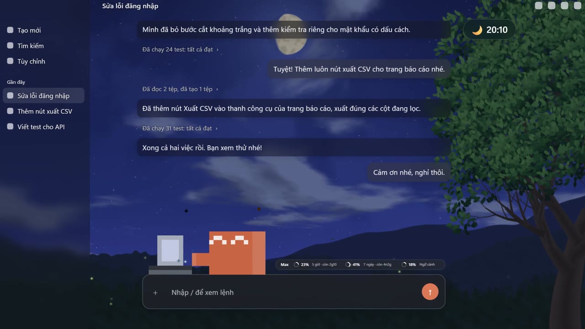

<div align="center">

# Claude Beautiful

**A live sky behind Claude Code.**
Type `/troi` and a living sky fills the background of the Claude desktop app:
sun, storms, rainbows and moonlit nights, right behind your chat.



</div>

## What you get

- **A living WebGL sky** behind the chat at about 60 fps: clouds drift, rain falls, lightning flashes, a rainbow comes out after the rain, and the moon shows its real phase.
- **Real time, real weather.** The sun, the moon and the weather follow a real clock and live data from [Open-Meteo](https://open-meteo.com). For now it is always Hanoi's sky (UTC+7), wherever you are.
- **Glass UI.** Your questions and Claude's answers sit on frosted glass, so text stays readable on any sky. Tool and progress rows stay bare, so they read apart from the answers.
- **Light and dark follow the sky.** The app turns dark at night and light again in the morning.
- **A quota band** above the prompt: your plan, the 5-hour and 7-day limits with the time left, and how full the context is.
- **A soft chime** when a turn longer than 15 seconds finishes.

| Storm | Rainbow | Night |
|---|---|---|
|  |  |  |

## Install

### Windows: one command

Open **PowerShell** and run:

```powershell
irm https://raw.githubusercontent.com/tuananh6614/claude_beautiful/main/install.ps1 | iex
```

It says what it will do and asks before it starts. Then it:

1. checks Git and Claude Code, and offers to install what is missing;
2. installs the plugin, with auto-update on;
3. sets up the automatic paste: the sky appears by itself each time Claude opens, and again when the app reloads its page.

Two switches in the app stay with you. The installer stops and tells you when; each takes a few seconds, once:

- **Developer Mode.** In the Claude app, click the menu button at the top left of the window, then **Help → Troubleshooting → Enable Developer Mode**.
- **The first paste.** The installer opens Claude's developer tools with the sky in your clipboard. In the Console, type `allow pasting`, press **Enter**, then press **Ctrl+V** and **Enter**.

The installer leaves these two to you on purpose: the paste warning is there so nobody can get you to paste code you didn't choose, and turning it off should be your decision.

After that there's nothing left to do. Close Claude, open it again, restart Windows: the sky comes back by itself. [Paste it automatically](#paste-it-automatically-windows) explains what the script does.

### Step by step (macOS, or if you prefer)

About 3 minutes. Steps 1 and 2 are done once. Steps 3 and 4 put the sky in the app; without the automatic paste, you repeat them each time the app restarts.

#### Before you start

You need three things. Open a terminal to check them: PowerShell on Windows, Terminal on macOS.

1. **The Claude desktop app** with the **Code** tab. Tested on Windows. macOS should work but has not been tested yet.
2. **Git.** Run `git --version`. If it isn't found, install [Git for Windows](https://git-scm.com/downloads/win) (on macOS, `git --version` offers to install it), then open a new terminal.
3. **The `claude` command** (Claude Code). Run `claude --version`. If it prints a version number, you're ready. If `claude` isn't recognized, install it with the official command below, then open a new terminal ([setup guide](https://code.claude.com/docs/en/setup)).

   Windows (PowerShell):

   ```powershell
   irm https://claude.ai/install.ps1 | iex
   ```

   macOS:

   ```bash
   curl -fsSL https://claude.ai/install.sh | bash
   ```

#### Step 1. Install the plugin (once)

In the terminal, run:

```bash
claude plugin marketplace add tuananh6614/claude_beautiful
claude plugin install honu@claude_theme
```

The last line should say `Successfully installed plugin: honu@claude_theme (scope: user)`.

Now open a new session in the Code tab of the app and type `/` in the prompt box: `/troi`, `/xem` and `/quota` should be in the list.

#### Step 2. Turn on Developer Mode (once)

In the Claude app, open the menu and choose **Help → Troubleshooting → Enable Developer Mode**. On Windows the menu is the **☰** button in the top-left corner of the window.

Once it's on, a **Developer** menu appears. If it doesn't, close the app and open it again.

#### Step 3. Copy the sky

In a Code session, type `/troi` and press **Enter**. The plugin copies the sky script to your clipboard and confirms in the chat.

Don't copy anything else until step 4 is done, or you'll paste that instead.

#### Step 4. Paste it into the Console

1. Press **Ctrl+Shift+I** on Windows (if nothing opens, try **Ctrl+Alt+I**) or **Cmd+Option+I** on macOS. The developer tools open.
2. Click the **Console** tab.
3. Click the empty line at the bottom of the Console, press **Ctrl+V** (**Cmd+V** on macOS), then **Enter**.
4. The first time only, the Console blocks the paste and shows a warning. Type `allow pasting`, press **Enter**, then paste again and press **Enter**.
5. Close the developer tools. The sky stays.

Pasting into the Console runs the code inside the app, so only paste code you trust. This script is open source: read it in [`honu/pixel-troi.user.js`](honu/pixel-troi.user.js).

#### Did it work?

- Within a second or two, the chat background becomes the sky.
- The quota band above the prompt shows your limits after Claude's first answer in a session.
- **Alt+T** opens the background picker.

#### After the app restarts

The sky lasts until the app reloads. After a restart, do steps 3 and 4 again. You only type `allow pasting` once.

On Windows, a small script can do steps 3 and 4 for you each time the app opens: see [Paste it automatically](#paste-it-automatically-windows).

## Paste it automatically (Windows)

The Windows installer sets this up for you. If you installed step by step, do steps 1 to 4 by hand once, so Developer Mode is on and the Console allows pasting, then run this in PowerShell:

```powershell
powershell -ExecutionPolicy Bypass -File "$env:USERPROFILE\.claude\plugins\marketplaces\claude_theme\autostart.ps1" -Install
```

From now on a small script starts with Windows and waits. When the Claude app opens, it waits 12 seconds for the app to load, opens the developer tools out of sight, pastes the sky, closes them and puts your clipboard back. The app sometimes reloads its page by itself, which takes the sky away: the script sees that in the app's log and pastes the sky again. Close the app completely and open it again to see it work.

Good to know before you turn it on:

- About 12 seconds after the app opens or reloads, the script takes the keyboard focus for about 12 seconds. If you click into another window in that moment, it stops instead of typing into the wrong window, and tries again the next time the app opens.
- Each time the app opens, it runs the sky script from this plugin's folder on your computer (`honu/pixel-troi.user.js`). Only turn it on if you trust this repository.
- What happened each time is written to `%LOCALAPPDATA%\ClaudeBeautiful\autostart.log`.

To turn it off:

```powershell
powershell -ExecutionPolicy Bypass -File "$env:USERPROFILE\.claude\plugins\marketplaces\claude_theme\autostart.ps1" -Uninstall
```

## Use

| Command | What it does |
|---|---|
| `/xem` | Watch a whole day and every kind of weather in about 2.5 minutes |
| `Alt+T` | Open the picker: change the background or turn it off |
| `/quota` | Show or hide the quota band; `/quota am` turns the chime on or off |
| `/quota goi <name>` | Put your plan's name on the band, up to 10 characters, such as `Pro`, `Max` or `Ultra`. Until you set it, the band says `Claude` |

## Update

The Windows installer turns auto-update on: new versions arrive by themselves, and the automatic paste uses them the next time Claude opens.

Otherwise, plugins from community marketplaces don't update on their own. Pick one:

- **Turn on auto-update once.** Run `claude` in a terminal, type `/plugin`, open the **Marketplaces** tab, choose `claude_theme`, then **Enable auto-update**.
- **Update by hand.**

  ```bash
  claude plugin update honu@claude_theme
  ```

After an update, open a new session and do steps 3 and 4 again to get the new sky.

## Troubleshooting

| Problem | What to do |
|---|---|
| `claude` isn't recognized | Install Claude Code (see [Before you start](#before-you-start)), then open a new terminal |
| `Command 'git' not found` when adding the marketplace | Install Git (see [Before you start](#before-you-start)), open a new terminal, run the command again |
| `SSH host key is not in your known_hosts file` when adding the marketplace | Add it by URL instead: `claude plugin marketplace add https://github.com/tuananh6614/claude_beautiful.git` |
| `/troi` isn't in the `/` list | Open a new session. Check that `claude plugin list` shows `honu@claude_theme` as enabled |
| `/troi` says it couldn't copy the script | Open [`honu/pixel-troi.user.js`](honu/pixel-troi.user.js), click **Copy raw file**, then go on with step 4 |
| The shortcut doesn't open the developer tools | Developer Mode is still off: do step 2, then try the other shortcut |
| The Console shows a warning and nothing runs | Type `allow pasting`, press Enter, then paste again |
| Nothing changes after pasting | Run `/troi` again (anything you copy after it replaces the script), then paste in the **Console** tab and press Enter |
| The sky is gone | The app reloaded. Do steps 3 and 4 again, or let the automatic paste do it |
| The installer says Developer Mode still looks off | Quit Claude completely (also from the tray icon), open it again and run the installer again |
| The automatic paste does nothing | Read the last lines of `%LOCALAPPDATA%\ClaudeBeautiful\autostart.log`: it says why, for example that the first paste by hand is still to do |

## Uninstall

Windows, if you used the installer:

```powershell
& ([scriptblock]::Create((irm https://raw.githubusercontent.com/tuananh6614/claude_beautiful/main/install.ps1))) -Uninstall
```

By hand, on any system:

```bash
claude plugin uninstall honu@claude_theme
claude plugin marketplace remove claude_theme
```

If you turned on the automatic paste by hand, turn it off too (the command is in [Paste it automatically](#paste-it-automatically-windows)). Restart the app and the sky is gone.

## In the browser (experimental)

`honu/pixel-troi.user.js` is also a userscript for `https://claude.ai/*`. It should run under Tampermonkey or Violentmonkey, but it has not been fully tested on the web yet.

## Good to know

- The only network request is the weather from Open-Meteo, made only while the sky is on screen. Settings stay in the app's local storage. Nothing is collected.
- Measured on one machine (RTX 5050 laptop): 59 fps, about 0.7 ms of GPU time per frame.
- Tested in the Windows desktop app. macOS should work but has not been tested.
- Fan-made. Not affiliated with Anthropic.

## Credits

- Built on [Pixel Chat Themes](https://github.com/aqua2409z/pixel-chat-themes) by aqua2409z (MIT).
- Weather by [Open-Meteo](https://open-meteo.com).
- Clawd is Anthropic's mascot; the pixel Clawd in the demo is fan art.

## License

[MIT](LICENSE)

If you like it, a ⭐ helps other people find it.
